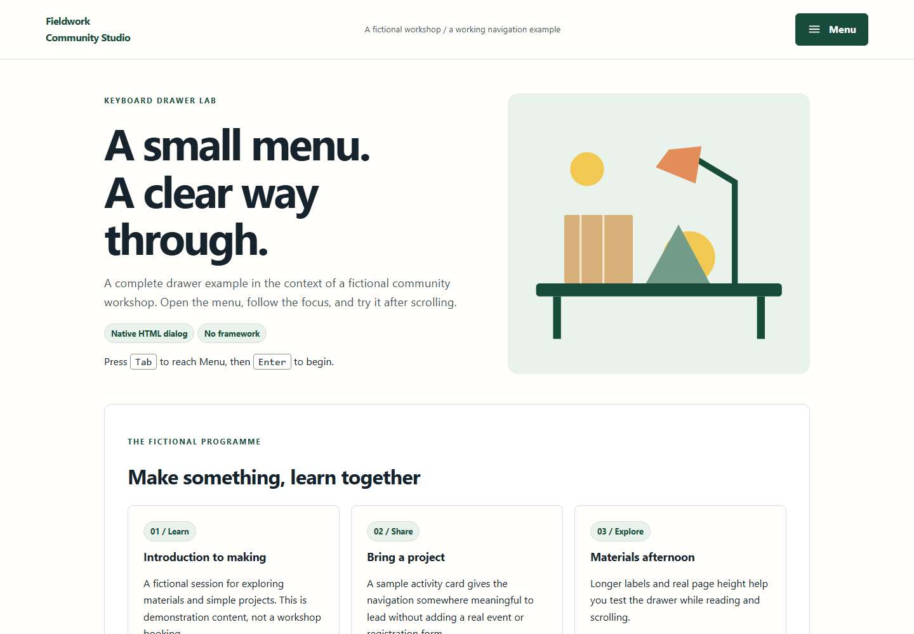

# Keyboard Drawer Lab

Keyboard Drawer Lab is a navigation drawer you can open, inspect and test using only a keyboard. It includes focus restoration, Escape handling, reduced motion and a practical test checklist.

Copy the small example or adapt it to a static website. The documented tests describe what has been checked, rather than promising accessibility certification. Maintained by [Nottingham Web Design](https://webdesignnottingham.uk/), operated by JW Digital Services Ltd.



## Start locally

Requires Node.js 22 or later. No runtime dependencies or account required.

```sh
npm ci
npm test
npm run build
npm run serve
```

Open http://127.0.0.1:4173/ for the complete local demonstration. Browser examples do not upload or persist entered data. The optional development server binds to loopback only.

## Input and output

The complete example uses a native modal dialog enhanced by a small module. Navigation remains visible when JavaScript is unavailable. The event log records control IDs, not entered text.

Use [examples/input.json](examples/input.json) as the complete input contract. Compare the generated [JSON result](examples/output.json), [Markdown report](examples/output.md) and [complete HTML](examples/output.html). The demo is in [demo/index.html](demo/index.html). It needs the local server for JavaScript modules. HTML reports can be opened as standalone files.

```sh
node cli.mjs examples/input.json --format json
node cli.mjs examples/input.json --format html --output report.html
node cli.mjs examples/input.json --format md --output report.md
```

This resource uses nested JSON input. See the complete example and `node cli.mjs --help`.

## Worked example

Use a fictional community workshop with four navigation items and a contact action. Include a long menu label, a small viewport, an embedded page anchor and a test page with enough content to scroll. This gives the drawer real conditions rather than an isolated empty overlay.

All supplied example records are synthetic. No clients, outcomes, current professional advice or real service availability are represented by them. Keep real records private and review output before sharing it.

## Checks

- Enter and Space operate the menu trigger. Focus enters the drawer, stays appropriately contained, and returns to the trigger on close.
- Escape, explicit close and navigation selection behave consistently. Hidden links are absent from the active keyboard sequence.
- Scroll locking restores the previous scroll position. Opening the drawer at 200% and 400% zoom does not lose its close control.
- Test Chromium, Firefox and WebKit, 320 px width, reduced motion and keyboard-only use. Record actual manual screen-reader checks separately.
- With JavaScript unavailable, visitors still have a usable navigation fallback. Example CSS does not hide all navigation before enhancement.

The automated results and browser checks performed for this release are recorded in [verification.md](docs/verification.md). Manual screen-reader testing has not been performed. A passing automated check is not accessibility certification.

## Contribute and maintain

Use [Issues](https://github.com/Web-Design-Nottingham/keyboard-drawer-lab/issues) for a reproducible bug and [Discussions](https://github.com/Web-Design-Nottingham/keyboard-drawer-lab/discussions) for questions and improvements. Follow [CONTRIBUTING.md](CONTRIBUTING.md); report vulnerabilities privately using [SECURITY.md](SECURITY.md). See [CHANGELOG.md](CHANGELOG.md) for releases. Maintenance is best effort.

Code, original illustrations and synthetic fixtures are MIT licensed. There is no required website backlink when reusing the resource. Commercial brand assets and third-party material are not included.
